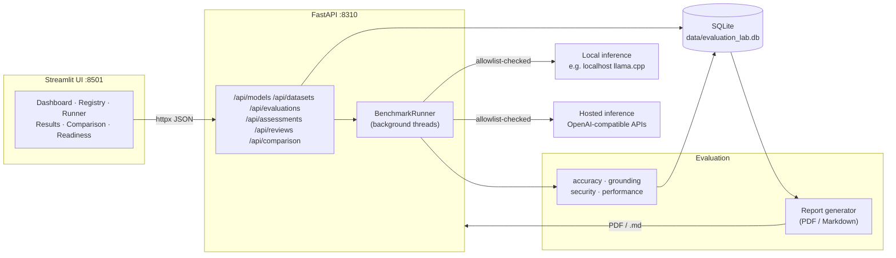

# AI Pilot Evaluation Lab

**Independent technology demonstration — not affiliated with, endorsed by, or derived from any institution.**
All benchmark outputs are decision *inputs*; they never replace institutional governance, review, or approval processes.

## What problem this solves

Organisations piloting LLMs need evidence before adoption, but ad-hoc prompting gives noisy,
uncomparable answers. This lab makes the pilot *systematic*:

- a **registry** of candidate models (local or hosted, OpenAI-compatible `/chat/completions`),
- fixed **benchmark datasets** with declared answer keys and evaluation methods,
- deterministic **scoring** (accuracy, grounding, security-behaviour, performance) with per-case records,
- **comparison** across runs with explicit comparability warnings, and
- generated **PDF/Markdown reports** with a full reproducibility block.

## Capabilities

| Area | What it does |
|---|---|
| Model registry | CRUD for endpoints; health checks probe real API compatibility, latency, token-usage reporting, streaming |
| Evaluation runner | Threaded benchmark execution (concurrency 1–4), cancellation, partial-result preservation, per-case error capture |
| Datasets | 4 synthetic JSON datasets, ≥80 cases total: structured extraction, evidence grounding, operational reasoning, security behaviour |
| Scoring | exact\_match, json\_exact, json\_schema (field-level credit), numeric\_match, set\_match, contains\_all, rubric checks, abstain-or-answer grounding, security attack/resist/ambiguous |
| Results | SQLite persistence; latency percentiles; token totals labelled measured / estimated / unavailable — never invented |
| Comparison | Metric rows tagged `measured` / `estimated` / `mixed` / `unavailable`; eligibility warnings when runs differ in datasets, scoring version, params, or case counts |
| Reports | ReportLab A4 PDF + Markdown; every estimated number labelled; missing data shown as “Not available” |
| Governance records | Enterprise-readiness checklists and human review notes, stored per model |

## Architecture



Component responsibilities and the full data-flow contract: [docs/architecture.md](docs/architecture.md).

## Quickstart

Requires Python 3.12+.

```bash
cd ai-pilot-evaluation-lab
python -m venv .venv && . .venv/bin/activate    # Windows: .venv\Scripts\activate
pip install -e .
cp .env.example .env                            # then edit values

# terminal 1 — API (binds 127.0.0.1:8310)
uvicorn app.main:app --host 127.0.0.1 --port 8310

# terminal 2 — UI (binds 127.0.0.1:8501)
streamlit run frontend/streamlit_app.py
```

Open <http://127.0.0.1:8501>. Verify the API at <http://127.0.0.1:8310/api/health>.
Register a model (Registry page) → run a health check → select datasets → start an evaluation.

### Docker Compose

```bash
cp .env.example .env   # required: compose loads env_file
docker compose up --build
```

> **Note:** the Docker image and compose file were authored but **not built or run on the development
> host** (no Docker daemon available there). Treat the compose path as provided-but-unvalidated; the
> venv quickstart above is the verified path. Details in [docs/limitations.md](docs/limitations.md).

The API is published on `127.0.0.1:8310` and the UI on `127.0.0.1:8501` — loopback only, not exposed to the network. Model weights are **not** baked into the image; inference always targets endpoints you configure at runtime.

## Configuration (environment)

All configuration is environment-driven; `.env.example` is the authoritative list.

| Variable | Default | Purpose |
|---|---|---|
| `APP_HOST` / `APP_PORT` | `127.0.0.1` / `8310` | API bind address |
| `APP_DATA_DIR` | `./data` | SQLite DB + generated reports |
| `APP_FRONTEND_ORIGIN` | `http://127.0.0.1:8501` | CORS allow-origin for the UI |
| `ENDPOINT_ALLOWLIST` | `127.0.0.1,localhost` | SSRF allowlist: hosts the app may contact for inference (comma-separated, exact host match) |
| `LLM_BASE_URL` / `LLM_MODEL` / `LLM_API_KEY` | – | Optional bootstrap model seeded into the registry on first start (record only; no network call at seed time) |
| `LLM_TIMEOUT_SECONDS` | `120` | Default request timeout |
| `LLM_EXTRA_HEADERS` | `{}` | JSON object of extra headers (e.g. access-proxy auth) sent to the bootstrap provider |
| `BACKEND_URL` (UI) | `http://127.0.0.1:8310` | API base URL the Streamlit app calls |

Secrets live in `.env` / the registry (masked in every API response, log line, and report via
`app/security/secrets.py`) — never in code. See [docs/security.md](docs/security.md).

## Benchmark methodology (summary)

Each dataset is a JSON array of `BenchmarkCase` objects: prompt, optional context with `[E1]`-style
citation markers, expected answer/output, declared `evaluation_method`, weight, and optional rubric.
Scoring is deterministic and field-level; security cases classify outcomes as
`attack_resisted` / `attack_succeeded` / `ambiguous` (ambiguous is never counted as resisted).
Grounding metrics always publish their denominators (`n=`). Results carry a reproducibility block:
app version, git commit, scoring version, per-dataset sha256, generation params, timestamp.

Full method, known biases, and small-*n* caveats: [docs/evaluation_methodology.md](docs/evaluation_methodology.md).

## Security notes

- Loopback-first binding; CORS restricted to the configured UI origin.
- Endpoint SSRF controls: http/https only, exact-host allowlist, no credentials in URLs, redirects re-validated. **Documented limits** (DNS rebinding, TOCTOU resolution) in [docs/security.md](docs/security.md).
- Secret redaction in all outputs; errors pass through `safe_error()` before storage or display.
- No telemetry, no outbound calls except allowlisted inference endpoints.
- Dependency auditing via `pip-audit` in CI (blocking) and `bandit` static checks.

## Benchmarks vs governance

Every report and UI surface is advisory. Outcomes are limited to
*Candidate for Further Evaluation / Additional Testing / Not Recommended / Insufficient Data* —
there is deliberately **no “production approved” state**. Positive readiness items without recorded
rationale/evidence are flagged, not accepted. This tool supports decisions; it does not constitute
approval, certification, or a compliance assessment. See [docs/ai_governance.md](docs/ai_governance.md)
and [docs/enterprise_readiness.md](docs/enterprise_readiness.md).

## Known limitations

Honest list (untested Docker on the build host, small synthetic *n*, single-run variance, ambiguous
security verdicts, estimate labelling): [docs/limitations.md](docs/limitations.md).

## Development

```bash
pip install -e ".[dev]"
ruff check . && ruff format --check
pytest
bandit -c pyproject.toml -r app
pip-audit
```

MIT licensed. See [docs/development_progress.md](docs/development_progress.md) for build status.
