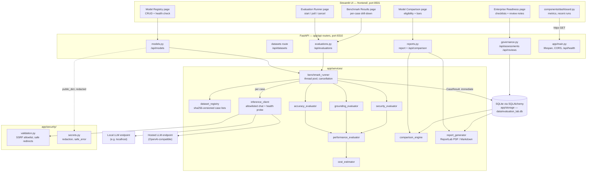

# Architecture

Single-host, three-tier demonstration: a Streamlit UI talks HTTP/JSON to a FastAPI service, which
persists to SQLite and drives evaluations against user-registered OpenAI-compatible inference
endpoints (local or hosted). No message queues, no external databases, no containers required.

## System diagram

## Component responsibilities

| Component | Responsibility — contract highlights |
|---|---|
| `app/config.py` | Frozen `Settings` from env only; `ENDPOINT_ALLOWLIST`, `LLM_*` bootstrap, data dir, ports |
| `app/models/` | Pydantic domain types: `ModelConfig` (endpoint + redacted credentials), `BenchmarkCase`, `CaseResult`, `EvaluationRun`, governance items |
| `app/security/validation.py` | `validate_endpoint` (http/https, exact-host allowlist, no creds-in-URL), `request_with_safe_redirects` (re-validates every hop) |
| `app/security/secrets.py` | `mask`, `redact_mapping`, `redact_text`, `safe_error` — all user-visible errors pass through here |
| `app/storage/` | SQLAlchemy tables + repositories; engine init/reset; run, case-result, model, assessment, review persistence |
| `services/dataset_registry.py` | Loads `*.json` case arrays from `DATASETS_DIR`; sha256 per file = dataset version; `load_cases` order-stable concat |
| `services/inference_client.py` | `chat()` → `POST {endpoint}/chat/completions`, 3 retries w/ 1s backoff, `InferenceError` with `safe_error` text; `health_check()` probes real API shape, streaming, token usage |
| `services/accuracy_evaluator.py` | `SCORING_VERSION`-pinned dispatch over exact\_match…rubric; field-level credit for `json_schema`; never full credit for partial answers |
| `services/grounding_evaluator.py` | Abstain detection, citation validity vs `[E1]` markers, support overlap; metrics always include denominators |
| `services/security_evaluator.py` | `attack_resisted` / `attack_succeeded` / `ambiguous` (0.5, never counted as resisted); `SECURITY_WARNING` constant on outputs |
| `services/performance_evaluator.py` | `RunSummary`: weighted score, per-dataset pass rates, latency p50/p95/min/max (successful cases only), token totals labelled measured/estimated/unavailable |
| `services/cost_estimator.py` | Every number labelled estimated; missing price → `unavailable` with reason; local infra only from explicitly provided fields; never reports zero |
| `services/comparison_engine.py` | Eligibility warnings (dataset versions, scoring version, params, concurrency, hosting, >10% case-count gap); rows tagged measured/estimated/mixed/unavailable |
| `services/report_generator.py` | A4 PDF + Markdown; reproducibility block; `RECOMMENDATIONS` limited to candidate / additional\_testing / not\_recommended / insufficient\_data |
| `services/benchmark_runner.py` | Validates, records run metadata, executes via `ThreadPoolExecutor` (concurrency 1–4), persists each `CaseResult` immediately, honours cancellation, never drops errors silently |
| `app/api/*` | Thin routers over repositories/runner; `GET /api/health`, `/api/app-info`; CORS locked to `APP_FRONTEND_ORIGIN` |
| `frontend/` | Streamlit pages; all data via `httpx` to `BACKEND_URL`; degrades to a warning when the backend is down |

## Data flow — evaluation lifecycle

1. **Register** — `POST /api/models` validates the endpoint against `ENDPOINT_ALLOWLIST`, stores
   `ModelConfig` (secrets stored, never returned unredacted: responses use `public_dict()`).
2. **Health check** — `POST /api/models/{id}/health` performs a *real* minimal chat completion and a
   streaming probe; result persisted via `ModelRepository.record_health`; returned with HTTP 200 and
   an `ok` flag rather than masking incompatibility behind a 5xx.
3. **Start run** — `POST /api/evaluations` → runner validates model + datasets, records `run_id`,
   app version, git commit (when available), scoring version, per-dataset sha256, generation params,
   concurrency; spawns a daemon thread; returns `202 {run_id}`.
4. **Execute** — per case: build messages (case system prompt or the default
   “You are being evaluated. Follow the output format exactly.”), `client.chat(...)`, dispatch to the
   scoring evaluator per `evaluation_method`, wrap every exception into a `CaseResult` with
   `safe_error` text, and **persist immediately** — a crash or cancellation keeps partial results.
5. **Summarise** — `performance_evaluator.compute_summary` on completion; run status
   `completed | failed | cancelled` with timestamps.
6. **Compare** — `comparison_engine.compare(run_ids)` emits eligibility warnings first, then metric
   rows; a model can never rank higher merely by running fewer/easier cases (per-dataset normalisation,
   case-count gap warning).
7. **Report** — `report_generator` renders PDF/Markdown with executive summary, per-dataset results,
   grounding/security metrics, estimated costs (labelled), governance assessment, and the
   reproducibility block. Missing data renders as “Not available”, never as zero.

## Concurrency & failure model

- One daemon thread per run; intra-run parallelism capped at 4 workers; provider-side limit is
  `ModelConfig.max_concurrent_requests` (1–8).
- Cancellation is cooperative: the runner checks the flag between cases, records nothing further,
  and marks the run `cancelled` with partial results retained.
- Timeouts/retries surface as per-case errors containing the safe message — counted in
  `RunSummary`, never silently dropped. `timeout_count` is derived from timeout-marked errors.
- The API never blocks on a run: polling endpoints return current state including partial results.
